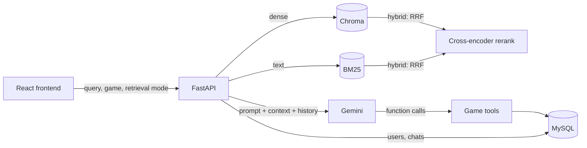

# Farewell Oregon — RAG Game Assistant

A retrieval-augmented chat assistant for **Days Gone** and **GTA 6**. Pick a game and a retrieval strategy, ask a question, and Gemini answers from a per-game knowledge base, calling game-specific tools when it needs exact data.

> Screenshot or GIF goes here: the chat with the game and retrieval pickers open.

## Highlights

- **Hybrid retrieval with reranking.** Dense (MiniLM + Chroma) and keyword (BM25) results are fused with reciprocal rank fusion, then reranked by a cross-encoder.
- **Measured, not guessed.** A free, local retrieval eval compares the three modes; a RAGAS eval scores full answers.
- **Multi-game by design.** Each game has its own knowledge base, vector collection, BM25 index, golden eval set and Gemini tools, selected per request.
- **Multi-step tool calling.** Gemini can call several tools in parallel and across rounds; tool errors go back to the model instead of crashing the request.
- **Production basics.** JWT auth with per-user chat ownership, streaming answers, `/health` and `/ready` endpoints, one timing log line per request, Docker Compose.

## Retrieval results

Paraphrased Days Gone questions (38), worded differently from the knowledge base so keyword matching can't simply copy the text:

| Mode | Hit rate @5 | MRR | Avg retrieval time |
| --- | --- | --- | --- |
| Text (BM25) | 86.8% | 0.783 | 1.7 ms |
| Dense (MiniLM) | 92.1% | 0.838 | 19.5 ms |
| **Hybrid (RRF + rerank)** | **97.4%** | **0.871** | 125.9 ms |

Hybrid finds the right chunk most often; the reranker costs about 100 ms per question on CPU. Hit rate = share of questions where a chunk containing the gold evidence is in the top 5; MRR = how high it ranks.

## Architecture



Requirements, capacity estimates, design decisions and their trade-offs are in [docs/architecture.md](docs/architecture.md).

## Tech stack

| Layer | Tools |
| --- | --- |
| Frontend | React, TypeScript, Vite |
| Backend | FastAPI, Python 3.12 |
| LLM | Google Gemini (`gemini-3.1-flash-lite`), function calling |
| Retrieval | ChromaDB, `all-MiniLM-L6-v2` embeddings, `rank-bm25`, `ms-marco-MiniLM-L-6-v2` cross-encoder |
| Data | MySQL 8 |
| Evaluation | RAGAS (answer quality), custom retrieval eval (hit rate, MRR) |
| Infra | Docker, Docker Compose |

## Games and tools

| Game | Knowledge base | Gemini tools |
| --- | --- | --- |
| Days Gone | `backend/Days Gone Data.md` (472 chunks) | `compare_weapons`, `zombie_details` |
| GTA 6 | `backend/GTA 6 Data.md` (89 chunks) | `get_character`, `get_region`, `compare_editions`, `get_game_facts` |

Adding a game means adding a knowledge base, a golden set and an entry in `backend/app/core/games.py`.

## Quick start (Docker)

1. Create a `.env` file next to `compose.yaml`:

   ```env
   GEMINI_API_KEY=your-gemini-api-key
   JWT_SECRET=a-long-random-secret
   DB_USER=root
   DATABASE_PASSWORD=choose-a-password
   DB_NAME=llm
   ```

2. Start everything:

   ```bash
   docker compose up --build
   ```

   MySQL loads the tables and seed data from `db/init/` on its first start. The backend indexes any game that isn't indexed yet.

3. Open `http://localhost:5173`. Check the backend at `http://localhost:8000/ready`.

## Local development

**Database.** Create the database, then run both scripts in `db/init/`:

```sql
CREATE DATABASE llm;
USE llm;
SOURCE db/init/01_schema.sql;
SOURCE db/init/02_gta6.sql;
```

**Backend** (Windows PowerShell):

```powershell
cd backend
python -m venv .venv
.\.venv\Scripts\Activate.ps1
pip install -r requirements.txt
copy .env.example .env    # then fill in your values
cd app
python -m uvicorn main:app --reload
```

**Frontend:**

```powershell
cd frontend
npm install
npm run dev
```

The frontend calls `http://localhost:8000` by default; set `VITE_API_BASE_URL` in `frontend/.env` to change it.

## Evaluation

Run from `backend/app`.

**Retrieval eval** (local, no API calls):

```bash
python -m eval.retrieval_eval --game days_gone
python -m eval.retrieval_eval --game gta6
python -m eval.retrieval_eval --golden "../Days Gone Paraphrase Eval.jsonl"
```

**Answer-quality eval** (RAGAS, uses Gemini):

```bash
pip install -r ../requirements-eval.txt
# set EVAL_GAME and EVAL_RETRIEVAL_MODE in backend/.env, then call GET /evaluate
```

Results are saved to `backend/eval_results/` with the git commit, settings and scores by question type.

| Golden set | Questions |
| --- | --- |
| `Days Gone Golden Eval.jsonl` | 189 (157 fact, 20 multi-field, 12 abstention) |
| `Days Gone Paraphrase Eval.jsonl` | 38 paraphrased |
| `GTA 6 Golden Eval.jsonl` | 110 (86 fact, 12 multi-field, 12 abstention) |

## Re-indexing

After editing a knowledge base:

```bash
python -m rag.indexer              # all games
python -m rag.indexer --game gta6  # one game
```

Then restart the backend so it loads the new BM25 index.

## Project structure

```text
backend/
  app/
    ai/             Gemini client, tool definitions and handlers
    auth/           JWT auth and password hashing
    core/           settings and the game registry
    db/             MySQL queries and connection pool
    eval/           RAGAS eval and retrieval eval
    hybrid_search/  BM25 index, RRF fusion, reranker
    LLM/            prompt template, query processing, token budgets
    rag/            chunking, embeddings, Chroma indexing and retrieval
    routers/        API endpoints
    services/       chat and user services
  *.md, *.jsonl     knowledge bases and golden eval sets
db/init/            schema and seed data
docs/               architecture and design decisions
frontend/src/       React app
```

## Known limitations

- The Gemini free tier allows about 15 requests per minute, which caps throughput.
- Gemini calls don't yet have timeouts or retries, and there's no per-user rate limit.
- Not yet load-tested; capacity figures in the architecture doc are estimates.
- The GTA 6 knowledge base covers facts available at launch (19 November 2026), not a full walkthrough.
