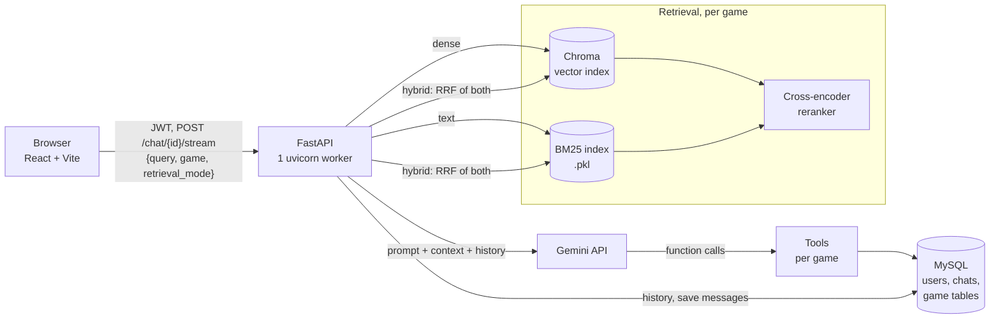

# Farewell Oregon — Architecture

A retrieval-augmented (RAG) chat assistant for video games. Users pick a game (Days Gone or GTA 6) and a retrieval mode (dense, text or hybrid); answers come from Gemini, grounded in a per-game knowledge base and per-game tools.

## 1. Architecture

### Request flow (streaming endpoint)

1. Frontend sends the question with the chosen `game` and `retrieval_mode`.
2. API checks the JWT and that the chat belongs to the user, then saves the question.
3. Loads chat history from MySQL and trims it to a 3,000-token budget.
4. Retrieves context for that game: dense (Chroma), text (BM25) or hybrid (RRF fusion of both, then cross-encoder rerank to top 5). Trims to a 3,000-token budget.
5. Renders one shared prompt template with the game's name.
6. Streams Gemini's answer. If Gemini asks for tools, the tool loop runs (up to 5 rounds) and the final answer is sent in one piece.
7. Saves the answer and logs one timing line for the request.

## 2. Requirements

**Functional**
- Chat with history, per user; users can't see each other's chats.
- Two games, picked per message; each game has its own knowledge base, indexes and tools.
- Three retrieval modes: dense, text, hybrid.
- Gemini tools: Days Gone (`compare_weapons`, `zombie_details`), GTA 6 (`get_character`, `get_region`, `compare_editions`, `get_game_facts`).
- Streaming answers.

**Non-functional (targets, not yet measured)**
- First streamed text in under 3 s for a typical question.
- Answers only from the knowledge base or tools; fixed "not enough information" reply otherwise.
- The app starts with MySQL down and returns 503s instead of crashing.

**Constraints**
- Gemini free tier: 15 requests per minute.
- CPU only (no GPU) for embeddings and reranking.
- Student budget: single machine first, cloud later.

## 3. Rough capacity numbers

| Item | Value | Note |
| --- | --- | --- |
| Knowledge base size | Days Gone 472 chunks, GTA 6 89 chunks | 550-character chunks |
| Gemini calls per chat | 1 + tool rounds (max 6) | Each counts against the 15/min limit |
| Max chats per minute | ~15 on the free tier | Gemini is the first hard limit |
| MySQL connections | 5 (`DB_POOL_SIZE`) | Pool raises an error when exhausted |
| Concurrent requests | ~40 | One uvicorn worker; sync endpoints use a ~40-thread pool |
| RAM per instance | ~1–2 GB (estimate) | MiniLM + cross-encoder + PyTorch; to be measured |
| Hybrid rerank cost | ~10 query–chunk pairs per question | CPU-bound; dense and text skip it |

## 4. Key design decisions

**Hybrid search with a reranker**
- *Decision:* fuse dense (MiniLM) and BM25 results with reciprocal rank fusion, then rerank with a cross-encoder.
- *Why:* dense handles paraphrases; BM25 handles exact names (weapons, characters, places), which games are full of.
- *Trade-off:* the reranker adds CPU time per question. Dense and text modes stay available as cheaper options and as eval baselines.

**One index per game**
- *Decision:* each game has its own Chroma collection and BM25 file, selected by the `game` in each request.
- *Why:* answers can't mix games, and each game can be re-indexed on its own.
- *Trade-off:* memory and startup work grow with each game added.

**MySQL for tool data, Chroma for text**
- *Decision:* structured facts (weapon stats, characters, regions, editions) live in MySQL tables behind tools; prose lives in the vector index.
- *Why:* exact lookups and comparisons are more reliable from rows than from retrieved text.
- *Trade-off:* facts can drift between the markdown and the SQL seed; both are maintained by hand.

**Indexing at startup**
- *Decision:* on startup, any game with an empty Chroma collection or a missing BM25 file is indexed.
- *Why:* a fresh container works with no manual step.
- *Trade-off:* only missing indexes are built, not stale ones, and every instance would index on its own. At scale, indexing becomes an offline job that publishes a versioned index.

## 5. Known limits and how it would scale

| Limit | What happens at ~100 concurrent users | Next step |
| --- | --- | --- |
| Gemini free tier (15/min) | Most requests get rate-limit errors | Paid tier, per-user rate limits, cache repeated questions |
| MySQL pool of 5 | Pool-exhausted errors | Larger pool that waits for a free connection |
| One uvicorn worker | Requests queue behind ~40 threads | Several workers, then several instances behind a load balancer |
| Reranker on CPU | Seconds of queueing in hybrid mode | Fewer candidates, a smaller model, or a separate reranking service |
| In-process BM25 and models | Each instance holds its own copy in memory | Acceptable at this size; shared services at larger scale |

## 6. Operability

- `GET /health`: liveness, returns `{"status": "ok"}` if the process answers.
- `GET /ready`: readiness, checks MySQL and every game's vector and BM25 index; 503 with the failing checks otherwise.
- One log line per chat request (logger `chat.timing`), for example:
  `chat_request game=gta6 mode=hybrid stream=True status=ok tool_rounds=1 history_ms=12 retrieval_ms=184 first_token_ms=903 llm_ms=2410 total_ms=2611`
- Log level is set with `LOG_LEVEL` (default `INFO`).
- *Trade-off:* logs are enough for one instance. At scale: metrics (Prometheus or CloudWatch) and tracing (OpenTelemetry) built from the same stage timings.

## 7. Open items

- Gemini calls have no timeout or retry yet.
- No per-user rate limiting yet.
- The normal (non-streaming) endpoint returns errors with HTTP 200.
- The question is saved before the answer, so a failed answer leaves an unanswered question in the history.
- Not yet load-tested; the numbers above are estimates.
